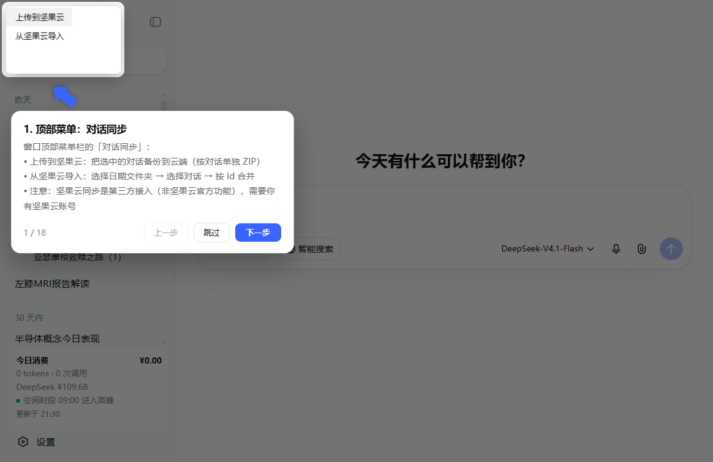
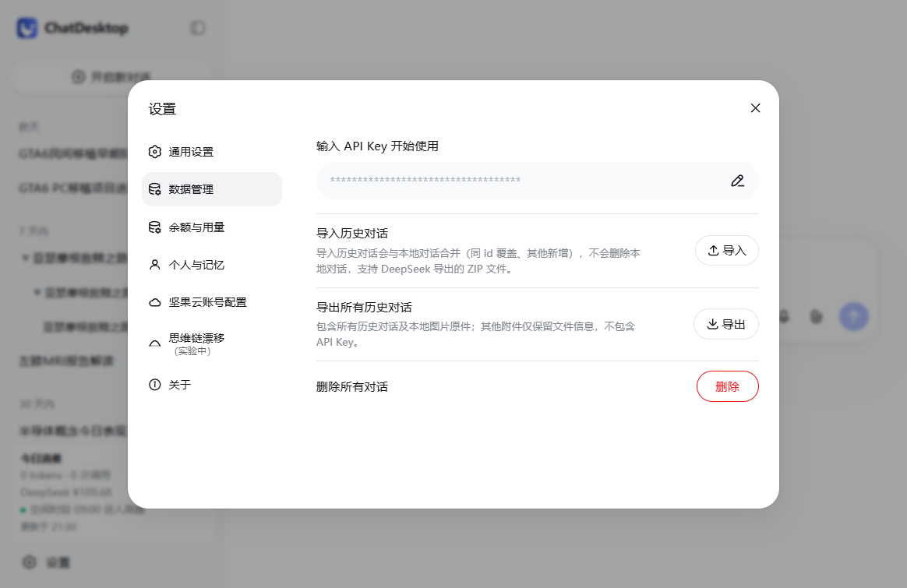
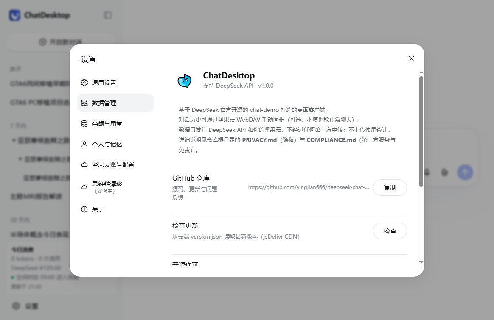

# ChatDesktop（DeepSeek 桌面客户端 · 坚果云 WebDAV 同步）

把 **DeepSeek 网页版**的聊天体验做成独立的 Windows 桌面应用。界面基于 DeepSeek 官方开源的 [chat-demo](https://github.com/deepseek-ai/chat-demo)，通过 **DeepSeek API** 对话，并支持**对话云同步**——用坚果云（Nutstore）的 WebDAV 把聊天历史手动备份到云端，换电脑、换设备时随时恢复。

**解决的痛点**：DeepSeek 网页版的对话存在浏览器里，换台电脑就没了。这个客户端把历史存到本机，并且可以手动备份到**你自己的坚果云**，在新设备上合并导入。

- **非官方产品**，与深度求索公司、坚果云均无隶属关系，也未获得其认证
- 数据只在你本机、DeepSeek API 和你的坚果云之间流转
- 同步完全手动，不做任何自动上传、不轮询、不在后台发请求

> 名字里的 “DeepSeek” 仅用于说明本软件调用的是 DeepSeek 提供的 API，不代表官方。

---

## 界面

首次启动有 18 步新手引导，箭头会指向当前要操作的位置：



数据都在「设置 → 数据管理」里，导入导出、清空都在这一页：



关于页显示版本、仓库地址和检查更新入口：



---

## 它是什么

把网页版的 DeepSeek 聊天做成了一个独立的桌面应用，并解决了「换电脑、跨设备时对话历史带不走」的问题：

- 聊天记录默认存在本机
- 想备份时，点一下菜单，把选中的对话打包上传到**你自己的坚果云**
- 换设备时，从坚果云导入，按对话 id 合并

不需要服务器，不需要账号系统，不经过任何第三方中转。

---

## 功能

**聊天**

- 流式回答、深度思考、智能搜索、模型切换（V4.1-Flash / V4-Pro）
- 图片与文件上传（代码、文档、PDF、图片等）
- 语音输入（麦克风转文字）

**对话管理**

- 对话列表按时间分组，分叉对话缩进显示
- 重命名、置顶、分叉、删除
- 长对话右侧导航条，快速跳到任意一轮

**对话云同步（可选）**

- 把聊天历史备份到你自己坚果云的 WebDAV，实现跨设备恢复
- 手动上传：按日期文件夹 + 每个对话单独 ZIP
- 手动导入：选日期 → 选文件 → 按 id 合并
- 冲突提示：云端已有同名文件时询问覆盖
- 个人偏好与记忆：每条一个 TXT，可单独导出/导入

**导入对话（本地 ZIP）**

- 导入前先列出压缩包里的**所有对话**，可以自己勾选要导入哪些（默认全选，支持全选 / 反选）
- **只导入勾选的对话，不会覆盖、也不会删除你现有的历史**
- 同一个对话（相同 id）会被备份里的版本更新，其余的作为新对话加入
- 兼容 DeepSeek 官方导出的 ZIP，也兼容本软件自己导出的备份

> **⚠️ 和官方 chat-demo 的行为不同**
>
> DeepSeek 官方 chat-demo 的导入是「**替换全部**」—— 导入一个备份，你现有的对话会全部被清掉
> （官方说明原文：`importing replaces all local conversations and attachments`）。
>
> 本软件改成了「**按对话 id 合并**」：导入只做增量，**不影响你现有的任何对话**，还能勾选只导入其中几个。
> 从官方 chat-demo 迁移过来时会觉得不一样，但数据更安全。

**其他**

- API Key 与坚果云账号走系统加密存储（不落明文）
- 余额与用量统计（今日消费、缓存命中、对话排行）
- 新手引导（18 步）

---

## 安装

### Windows

1. 下载最新的 `ChatDesktop-1.1.0-Setup.exe`（[Releases 页面](https://github.com/yingjian666/deepseek-chat-webdav-jianguoyun/releases/latest)）
2. 双击安装（当前用户安装，不需要管理员权限）
3. 首次启动会弹出新手引导

> **系统要求**：Windows 10 及以上（Electron 45 的限制）。
> **不需要**安装 Node.js、.NET、VC++ 运行库或 WebView2——浏览器内核和运行时已经全部打包在安装包里。

#### ⚠️ 首次运行会提示「Windows 已保护你的电脑」

这是 Windows SmartScreen 对**未签名程序**的默认提示，不是病毒，也不是安装包损坏。

本项目是个人开源项目，没有购买代码签名证书（每年约 1000–4000 元），所以系统没法验证发布者身份。

**两种放行方式，任选一种**：

- **弹窗出现时**：点「更多信息」→ 再点「仍要运行」
- **更彻底**：下载后右键安装包 → 属性 → 最下面勾选「解除锁定」→ 确定，然后双击就不会再提示

如果你是从 **U 盘、微信、迅雷** 拷来的文件，可能根本不会弹——这些渠道不会给文件打「来自互联网」标记，Windows 就不会检查。只有从**浏览器**或**邮件**下载才会触发。

---

## 首次使用

### 1. 填 API Key（必须）

- 到 [platform.deepseek.com](https://platform.deepseek.com/) 创建一个 API Key
- 打开软件 → 设置 → 数据管理 → 填入 Key
- Key 会存进系统加密存储，不会写进配置文件

### 2. 配置坚果云（可选）

只用聊天的话可以跳过。

- 登录坚果云网页版 → 账户信息 → 安全选项 → **添加应用密码**
- 软件 → 设置 → 坚果云账号配置 → 填入邮箱和应用密码
- 应用密码只用于 WebDAV，和登录密码不是一回事，可以随时吊销

---

## 对话同步怎么用

### 上传

1. 顶部菜单 → 对话同步 → 上传到坚果云
2. 勾选要上传的对话（分叉会自动带上父对话）
3. 选中的对话 ≥ 2 个时，选择「合并成一个 ZIP」或「每个单独」
4. 如果云端已有同名文件，会询问是否覆盖

文件会存到：

```
坚果云/chat/chat/2026年11月23日对话/对话名-a1b2c3d4.zip
```

### 导入

1. 顶部菜单 → 对话同步 → 从坚果云导入
2. 选一个日期文件夹
3. 勾选要导入的 ZIP（可全选/反选）
4. 导入时**按对话 id 合并**：同 id 覆盖、新 id 新增、本地独有的保留

> 导入不会删除你本地的任何对话。

### 导入本地 ZIP 文件

适用于别人分享给你的备份，或者你自己导出的 ZIP 文件：

1. 设置 → 数据管理 → 「导入历史对话」→ 点「导入」
2. 选一个 `.zip` 文件
3. **弹出对话清单**：勾选要导入的对话（默认全选，底部有「全选 / 反选」）
4. 点「导入选中」

> **勾哪些就导入哪些。** 没勾的不会进来，你本地已有的对话也一条都不会被删。
> 如果 ZIP 太老、里面没有索引文件，会退化为「全部合并」，同样不删除本地数据。

---

## 常见问题

**Q：对话云同步为什么是手动的？**
A：坚果云对 WebDAV 有频率限制（免费版每 30 分钟 600 次请求），自动同步很容易触发限流；而且后台悄悄上传一旦出错，数据很难挽回。宁可多按一次按钮。

**Q：换电脑后对话怎么带过去？**
A：旧电脑做一次对话云同步（上传到坚果云）→ 新电脑导入。前提是把 API Key 和坚果云账号在新电脑上重新配置一次。

**Q：导入会覆盖我本地的对话吗？**
A：不会。无论从坚果云导入还是导入本地 ZIP，都是「按对话 id 合并」——同 id 的用备份里的版本更新，其余的作为新对话加入，**你本地独有的对话不受影响**。导入本地 ZIP 时还能勾选只导入其中几个，没勾的完全不会进来。

> 这一点和 DeepSeek 官方 chat-demo 不同：官方导入是「替换全部本地对话」，本软件改成了合并。

**Q：支持手机吗？**
A：PC 版优先，移动端在规划中。

**Q：检查更新连不上怎么办？**
A：更新源有 Gitee / GitHub / jsDelivr 三个，会自动选最快的。国内网络下通常 Gitee 可用。

---

## 许可与声明

- 开源许可：[NOTICE.md](NOTICE.md)
- 隐私说明：[PRIVACY.md](PRIVACY.md)
- 第三方服务与免责：[COMPLIANCE.md](COMPLIANCE.md)

**本软件是第三方客户端，非 DeepSeek 或坚果云官方产品，也未获得其官方认证。**
